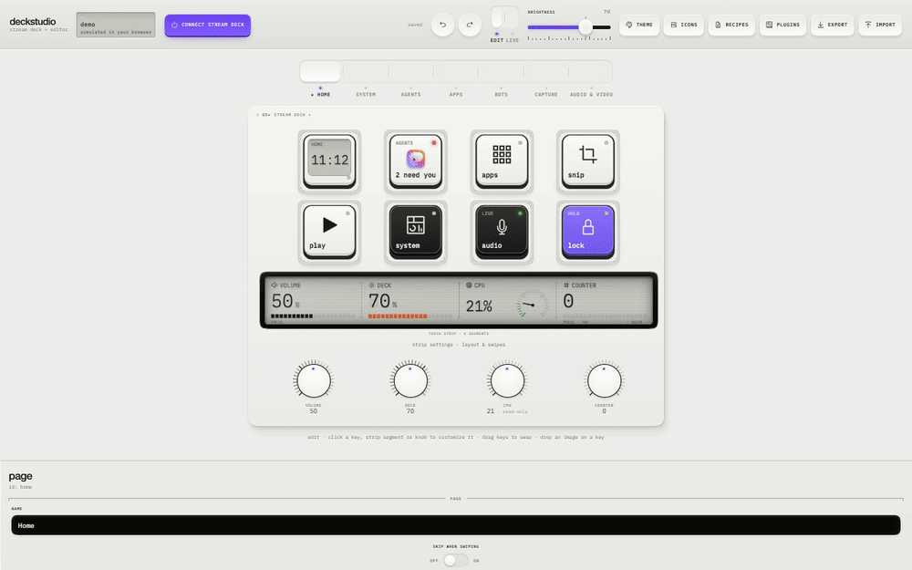
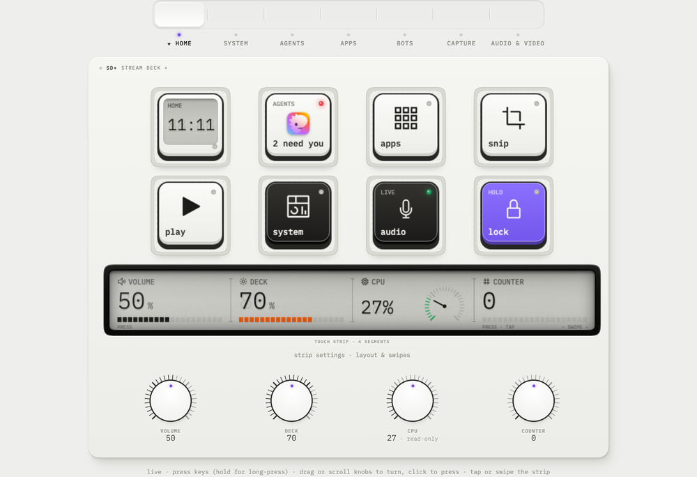
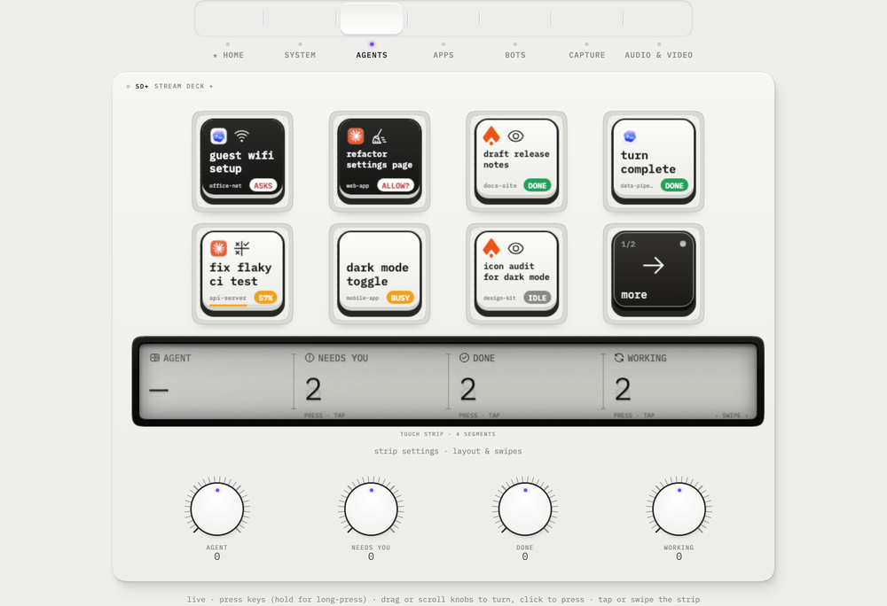
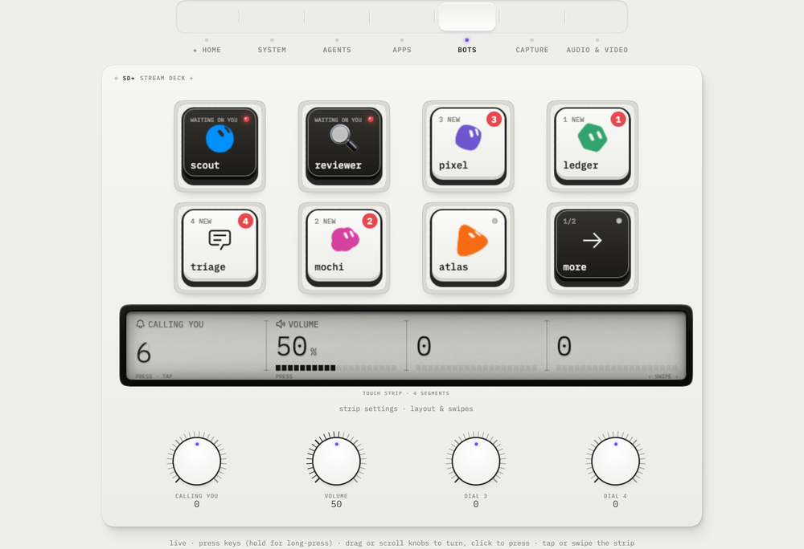
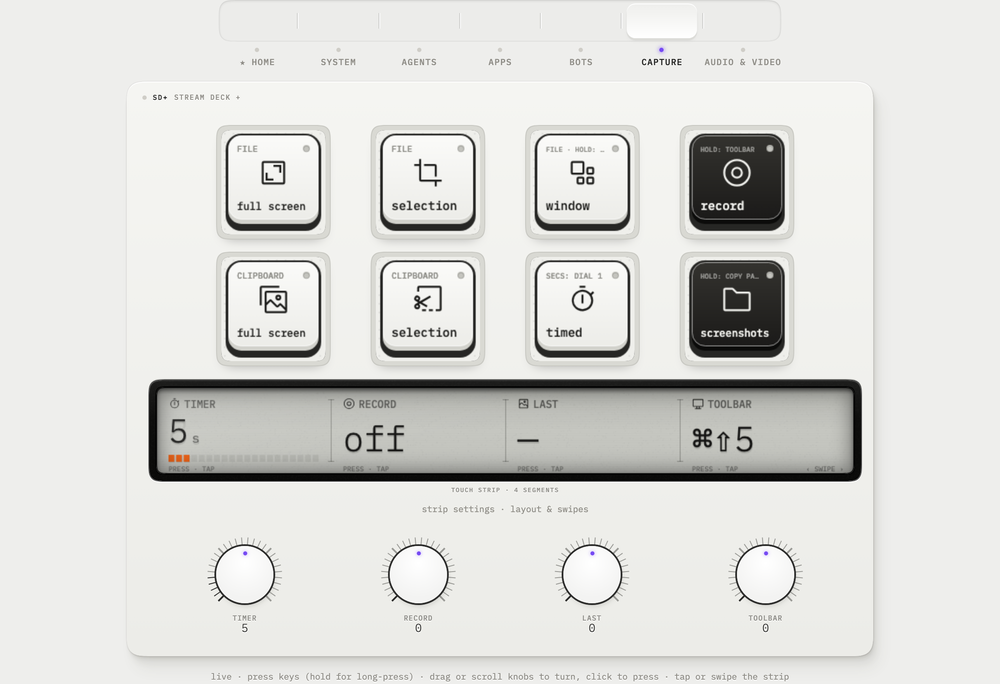

# DeckStudio

**An open-source SDK and editor for the Elgato Stream Deck+.** It talks to the device directly over USB HID, so it works **without Elgato's app**, and gives you what Elgato's SDK can't: a full-width 800 px canvas on the touch strip and raw swipe events.

> **Not affiliated with, endorsed by, or sponsored by Elgato or Corsair.** "Stream Deck" and "Elgato" are trademarks of their owners and are used only to say which hardware DeckStudio works with. See [Trademarks](#trademarks-and-non-affiliation).

<p align="center">
  
  <br><sub>The public browser demo (simulated Stream Deck+, sample data only). Regenerate with <code>npm run record:demo</code>.</sub>
</p>

**Try it in your browser, no device needed: <https://deckstudio.vercel.app>**
(the live demo; not deployed yet, see [docs/HOSTING.md](docs/HOSTING.md))

<table>
  <tr>
    <td width="50%"><br><sub><b>Home.</b> Keys, a four-segment touch strip and four dials.</sub></td>
    <td width="50%"><br><sub><b>Agents.</b> Every session that needs you, finished or is working, most urgent first.</sub></td>
  </tr>
  <tr>
    <td width="50%"><br><sub><b>Bots.</b> Bring your own bots with one JSON document; Grok Bot is built in.</sub></td>
    <td width="50%"><br><sub><b>Capture.</b> Screenshots and screen recording on a key.</sub></td>
  </tr>
</table>
<sub>Stills of the browser demo with sample data, regenerated by <code>npm run record:demo</code> (or <code>node test/e2e/record-demo.mjs --stills</code> for the stills alone).</sub>

The editor runs at <http://127.0.0.1:7337> and shows a live mirror of the hardware.

## Features

- **Keys, dials and strip.** 8 LCD keys, 4 push-dials, the 800x100 touch strip (four 200 px segments or one full-width canvas). Any number of pages; swipe the strip to change page. Press, long-press, turn, tap, long-tap and swipe all run actions: shell, URL/app/file, keyboard shortcut, type text, AppleScript, Shortcuts, HTTP, media keys, volume, brightness, sequences.
- **SPEC-01 look.** The device is drawn in the hardware style of [SPEC-01](https://github.com/shuding/spec-01): off-white keycaps in a dotted panel, IBM Plex Mono legends, LED lamps, gray reflective LCD windows and a segmented-meter strip. About 2,600 Carbon icons as glyphs. The editor previews use the same renderer, so they match the device pixel for pixel. A classic dark style is one click away.
- **App-aware pages.** Give a page one or more apps and the deck switches to it while one of them is in front, like Elgato's smart profiles.
- **Agent alerting.** An Agents page lists every agent that needs you, finished, or is working, most urgent first, with red / green / amber lamps and a strip that flashes from any page. Built in for **Rex** terminal sessions (read live), and for **Claude Code, Codex or any agent** through a small hook (`bin/deck-agent-hook`) or the HTTP API. Press a key to jump to the session.
- **Bring your own bots.** Any bot or agent app joins with one small JSON document: a file in `~/.deckstudio/bots/`, a `POST /api/bots`, or a command that prints it. **Grok Bot** support is built in. Bind a key to one bot or show them all on a page.
- **Capture.** Screenshot (full screen with a timer, window or selection; to file or clipboard) and screen recording on a key, with the permission and error cases handled.
- **Audio and camera.** Switch microphone and output, mute the mic, see when a camera is in use. Hold-to-talk keys for dictation apps.
- **Icon Studio.** Turn any logo, glyph, app icon or upload into pixel art (1-bit, Game Boy, amber CRT, CGA, duotone; Floyd-Steinberg, Atkinson, Bayer, ASCII) previewed on a real keycap.
- **Recipes.** 31 ready-made keys, dials and pages. Apply one, or copy its **setup prompt** into Claude Code or Codex and let the agent adapt it.
- **Plugins and a marketplace.** A macOS tool joins the deck with one manifest (`deckstudio.json`): how to detect it, where its status comes from, which actions keys can run, and key/dial/page templates that become recipes. DeckStudio never loads plugin code; plugins run only what they declare, under permissions you grant. The marketplace's plugins (CodexBar, RepoBar, Poltergeist adapters and more) ship in [registry/](registry/README.md), so it works offline and `git pull` updates it. Spec: [docs/PLUGINS.md](docs/PLUGINS.md).
- **SDK (Swift and TypeScript).** Small libraries that write atomic status files with a heartbeat, handle a control token and validate your manifest: [sdk/README.md](sdk/README.md).
- **MCP server.** `bin/deckstudio-mcp` lets agents read the deck, flash status, edit keys and dials safely (dry-run supported), apply recipes and run actions of plugins you enabled: [docs/MCP.md](docs/MCP.md).
- **Scripting.** `deckctl key 3 --label "Build" --bg "#1d5f3a"`, `deckctl toast ...`, `deckctl log -f` and a token-protected HTTP API. Changes are temporary overlays unless you pass `--persist`.

## Requirements

- macOS 13 or later
- Node.js 22 or later
- Xcode Command Line Tools (`xcode-select --install`), to build the small Swift helper (`bin/deckhelper`) that lists audio devices, cameras and running apps
- An Elgato **Stream Deck+**. Other models are untested; they may partly work but are not supported.

Only the editor demo runs elsewhere (any modern browser).

## Quick start

```sh
git clone https://github.com/il-figlio/deckstudio && cd deckstudio
npm install
npm run build              # Swift helper + the editor (into web/dist)
./bin/deckctl start --takeover   # quits the Elgato app and grabs the device
./bin/deckctl open               # opens the editor (with a one-time login code, never the token itself)
```

- **Release** in the editor, or `deckctl release`, hands the device back to the Elgato app. `deckctl stop` shuts DeckStudio down.
- Only one program can own the device at a time (macOS opens HID devices exclusively), so the **Elgato app is quit while DeckStudio owns the device**.
- If you only want the helper: `npm run build:helper`. Without it, audio, camera and app-detection features stay off and everything else works.

## Permissions

macOS asks the **app that runs DeckStudio** (Terminal, iTerm, or whatever launched `node`), not DeckStudio itself:

| Permission | Needed for | Where |
|---|---|---|
| **Accessibility** | "Keyboard shortcut", "Type text" and hold-to-talk keys, which synthesize key presses | System Settings → Privacy & Security → Accessibility |
| **Screen Recording** | Capture keys (screenshots and screen recordings) | System Settings → Privacy & Security → Screen Recording |
| Microphone / Camera | Not requested: DeckStudio reads device *lists* and the camera-in-use flag only | |

Without a permission, only the features above stop working, and DeckStudio tells you which one on the deck and in the editor.

## Architecture

```
 Stream Deck+ ──USB HID── server.mjs (127.0.0.1:7337) ──HTTP + WebSocket── editor (browser)
                              │            ▲
              engine · render · actions    └── deckctl · MCP · agent hooks · plugins · bots
                              │
                   bin/deckhelper (Swift: audio, camera, apps)
```

- `server.mjs`: local server. HTTP + WebSocket, token and host checks ([SECURITY.md](SECURITY.md)).
- `src/engine.mjs`: device lifecycle, input routing, pages, pollers. `src/actions.mjs`: action executors.
- `src/render.mjs`, `src/render-spec.mjs`: draw every surface with Skia (`@napi-rs/canvas`). The editor previews are the same pixels the device shows.
- `src/plugins.mjs`, `src/bots.mjs`, `src/agents.mjs`, `src/rex.mjs`, `src/capture.mjs`: plugins, bots, agent alerting, Rex, capture.
- `editor/`: React + Vite, built into `web/dist`. It uses the SPEC-01 hardware kit on Vercel's UI SDK (`@ui-sdk/react`). Kit sources are in `editor/src/components/ui/` and are yours to change.
- `editor/src/demo`: the browser-only demo, an in-browser engine that uses the same renderer.
- `sdk/`: Swift and TypeScript SDKs, examples. `plugins/`: built-in plugins. `registry/`: the plugin marketplace (community plugins, offered for install, never loaded from there). `bin/`: `deckctl`, `deckstudio-mcp`, `deck-agent-hook`, the helper.
- Your data lives outside the repo, in `~/.deckstudio` (`profile.json`, `token`, `server.log`, `bots/`, `plugins/`).

Dev loop for the editor: `cd editor && npm run dev`, then `bin/deckctl open --dev` (prints a one-time login link to `http://localhost:5610`: open it while your dev server is the one on that port).

## Documentation

| | |
|---|---|
| [docs/AGENT-GUIDE.md](docs/AGENT-GUIDE.md) | Everything an agent (or you) needs to drive the deck: API, profile format, bots, agent alerts |
| [docs/PLUGINS.md](docs/PLUGINS.md) | Plugin manifest spec (`plugin/v1`), permissions, marketplace |
| [docs/MCP.md](docs/MCP.md) | MCP server: setup for Claude Code, Codex and others, tool list |
| [docs/HOSTING.md](docs/HOSTING.md) | Building and hosting the browser demo |
| [registry/README.md](registry/README.md) | The plugin registry: layout, checks, contributing a plugin, review checklist |
| [sdk/README.md](sdk/README.md) | Swift and TypeScript SDKs, examples |
| [CONTRIBUTING.md](CONTRIBUTING.md) · [SECURITY.md](SECURITY.md) · [CHANGELOG.md](CHANGELOG.md) | Project |

## Personal pages (stay on your Mac)

Pages, keys and recipes you don't want in a public repo (internal apps, private paths, your own scripts) go in `src/local-profile.mjs`, which is gitignored. Copy `src/local-profile.example.mjs` to start. Your own plugins go in `plugins/local/`. Your saved profile, token and logs already live outside the repo, in `~/.deckstudio`.

## Tests

```sh
npm test                 # unit tests (hermetic: temp DECKSTUDIO_HOME and HOME)
npm run typecheck        # editor
npm run test:e2e         # builds the demo, runs the browser audits (Playwright)
npm run test:swift       # Swift helper build and the DeckKit package tests (macOS)
```

## Credits

DeckStudio stands on other people's work; licenses are in [THIRD_PARTY_NOTICES.md](THIRD_PARTY_NOTICES.md).

- **[SPEC-01](https://github.com/shuding/spec-01)** by **Shu Ding** (MIT): the hardware look: keycaps, LCD windows, knobs and the device frame, in the editor and redrawn on the device.
- **[Vercel UI SDK](https://github.com/vercel-labs/ui)** (`@ui-sdk/react`, Apache-2.0): the component layer SPEC-01 is built for.
- **[Carbon Design System](https://github.com/carbon-design-system/carbon)** icons by IBM (Apache-2.0): the glyph library.
- **[IBM Plex Mono](https://github.com/IBM/plex)** (SIL Open Font License 1.1): device and editor type.
- **[node-elgato-stream-deck](https://github.com/Julusian/node-elgato-stream-deck)** by Julian Waller (MIT): USB HID and WebHID device access.
- [`@napi-rs/canvas`](https://github.com/Brooooooklyn/canvas), [`omggif`](https://github.com/deanm/omggif), [`ws`](https://github.com/websockets/ws), the [MCP SDK](https://github.com/modelcontextprotocol/typescript-sdk).

## Trademarks and non-affiliation

DeckStudio is an independent project. It is **not affiliated with, endorsed by, or sponsored by Elgato, Corsair, or any company whose product it works with**. Elgato, Stream Deck and Corsair are trademarks of Corsair Memory, Inc. and its subsidiaries; all other names and logos (including Claude, Codex, ChatGPT, Rex, Grok Bot, Hex and similar app marks) belong to their owners.

Third-party app logos and Grok Bot sprites are included only to identify those apps on a key, for non-commercial use, and are **not** covered by the MIT license. If you own one and want it removed, open a "logo takedown" issue and it will be removed promptly. Details: [THIRD_PARTY_NOTICES.md](THIRD_PARTY_NOTICES.md).

## License

[MIT](LICENSE) © DeckStudio contributors. Third-party assets keep their own licenses; see [THIRD_PARTY_NOTICES.md](THIRD_PARTY_NOTICES.md).
